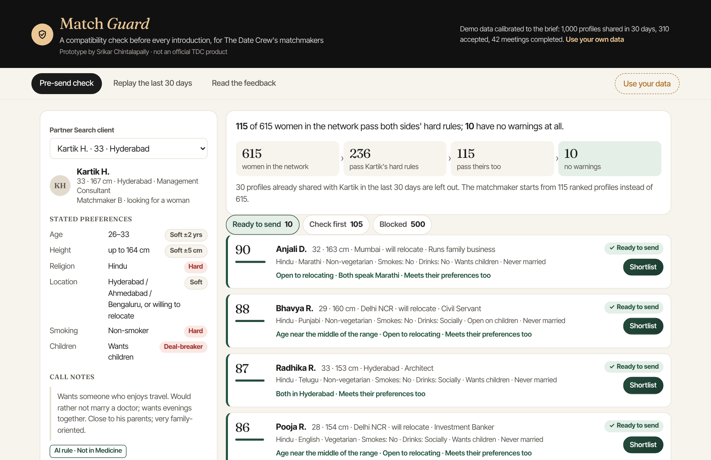
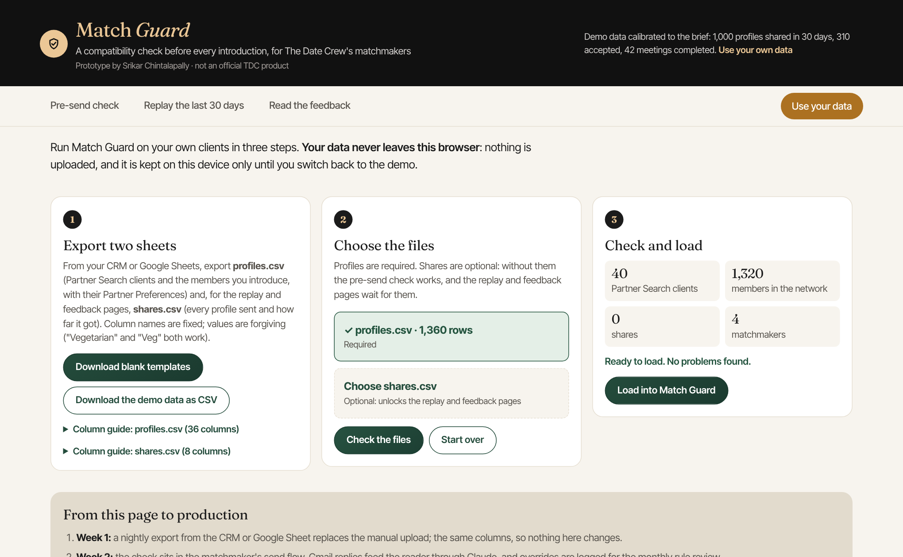

# Match Guard

[](https://github.com/SrikarsharmaC/match-guard/actions/workflows/ci.yml)

A compatibility check before every introduction, for The Date Crew's matchmakers. Before a profile goes to a Partner Search client, Match Guard checks it against both people's Partner Preferences, so "compatibility-checked" is true for every introduction. Built for the Product Growth assessment, styled to sit alongside thedatecrew.com, and ready to run on real data today. It is a prototype by Srikar Chintalapally, not an official TDC product.

**Live tool:** https://srikarsharmac.github.io/match-guard/ · **Walkthrough (76 s):** [docs/match-guard-walkthrough.mp4](docs/match-guard-walkthrough.mp4) · **Write-up:** linked in the submission



## The problem

In the last 30 days, 1,000 profiles were shared and 690 were rejected. About 35% of those rejections (~242) cited a reason already in the client's preferences. That means **24% of everything matchmakers send fails a preference we were already told**. It costs matchmaker time (search runs about 2 hours per client per week) and it tells paying clients we didn't listen.

## What Match Guard does

1. **Two-way check before sending.** Every candidate is checked against the client's stated preferences and deal-breakers, and against the candidate's own preferences about the client, because contact details are only shared when both say yes. Hard rules block (an override needs a logged reason). Soft rules warn with the reason. Missing data is flagged, never assumed OK.
2. **Ranked shortlist.** Profiles that pass are ranked by an explainable fit score, so search starts from ~115 pre-qualified profiles instead of ~600.
3. **Strictness set by data.** A rule blocks only if clients almost never accept a profile that breaks it (under 5% in the last 30 days). Smoking, children, religion and diet qualify. Missing someone's age range by 1–2 years does not: 30% of those were accepted anyway.
4. **Feedback reader.** Free-text rejections become reason codes and one of six buckets: avoidable, new preference, taste, timing, presentation, vague. Each bucket has its own next action. The demo uses offline keyword rules; production uses Claude with a forced tool call (structured JSON), in `src/llm.js`.

5. **Runs on your own data.** Export two sheets from the CRM or Google Sheets (`profiles.csv`, `shares.csv`), load them on the *Use your data* page, and every view runs on your real clients. Every problem is reported by file, line and column before anything loads. The data stays in the browser (IndexedDB) and is never uploaded.



## Results on mock data

The mock data reproduces every number in the brief: 1,000 shares, 310 accepted, 210 contacts, 150 conversations, 75 meetings fixed, 42 completed, 35% of rejections avoidable, Matchmaker A at 44% and B at 21%.

| Metric | Today | With Match Guard (hard rules only) |
| --- | --- | --- |
| Avoidable rejections caught | none | 237 of 242 (146 blocked, 91 flagged) |
| Blocked shares that would have failed anyway | none | 257 of 263 (97.7%) |
| Mutual matches per 100 shares | 21.0 | 28.3 |
| Profile acceptance | 31% | 36% |
| Completed meetings a month | 42 | ~57 (+35%) |
| Matchmaker B acceptance | 21% | 30% |

Projection method: each blocked share is replaced by a profile that performs like today's clear ones (38.4% accepted, 78% of those reach contact, 20% of contacts become completed meetings). Run `npm run backtest` to reproduce.

## Run it

- **Tool:** open `index.html` in any browser, or the live link above. No install, no server, no sign-up; everything is in that one file.
- **Your own data:** open *Use your data*, download the templates (or use `templates/`), fill them from your CRM, load. Column guide below.
- **Requirements for the scripts:** Node 18 or later. There are no dependencies.

```bash
npm run data       # regenerate data/mock-data.json, checked against the brief
npm run backtest   # print the impact numbers above
npm test           # 13 tests: rules engine, CSV import, round trip
npm run templates  # write the CSV templates and the demo data as CSV into templates/
npm run build      # rebuild index.html from src/
ANTHROPIC_API_KEY=sk-ant-... node scripts/llm-classify.mjs --n 30   # Claude vs keyword rules vs labels
node scripts/llm-classify.mjs --dry-run                             # show the exact request, no key needed
```

## Your data: the two files

| File | One row per | Required columns | Notes |
| --- | --- | --- | --- |
| `profiles.csv` | client or candidate | `id`, `name`, `role`, `gender`, `seeking`, `age` | 36 columns in all: attributes, `pref_*` preferences, `dealbreakers`, `call_notes`. Lists use `\|`. Blank = not recorded, which is flagged, never assumed OK. |
| `shares.csv` | profile sent to a client | `date`, `matchmaker`, `client_id`, `candidate_id`, `furthest_stage` | Optional. Unlocks the replay and feedback pages. `feedback` holds the client's reply; `reason_bucket` is optional if matchmakers already tag reasons. |

The full column guide is on the *Use your data* page. A test exports the demo data to these two files, imports them back and checks that every backtest number and every verdict is identical, so the CSV path loses nothing.

## Repository

```
index.html                     built prototype (open directly, or serve with GitHub Pages)
src/engine.js                  rules engine, fit score, pool search, backtest, calibration, feedback parser
src/llm.js                     Claude prompt, JSON schema (tool) and API call for feedback
src/importer.js                CSV import/export, validation report, templates
src/app.js, styles.css         the UI (vanilla JS), including the Use your data page
src/index.template.html        page shell used by the build
scripts/generate-mock-data.mjs mock data calibrated to the brief, verified with the engine
scripts/backtest.mjs           impact numbers
scripts/llm-classify.mjs       LLM evaluation against labelled replies
scripts/build.mjs              inlines everything into index.html
scripts/export-templates.mjs   writes templates/
test/                          engine and importer tests
templates/                     blank CSV templates and the demo data as CSV
docs/                          76-second walkthrough video
screenshots/                   the four views
.github/workflows/ci.yml       tests, backtest numbers and build check on every push
```

## Design decisions

- **Rules, not a model, for the core.** A third of rejections are knowable from data already held. Deterministic rules are explainable to a matchmaker, auditable, and shippable by one person in two weeks.
- **AI only where the data is free text.** Call notes become proposed rules; rejection replies become reasons. Both need a matchmaker's approval before they change anything.
- **Learned preferences never block.** In the data, clients often reject a profile and later accept a near-identical one. Feedback can add soft warnings; only deal-breakers and rules proven hard by behaviour can block.
- **Two-way by default.** Of the 45 profiles clients accepted that broke the other person's own rules, 40 stalled before contact details were shared.
- **Unknown is not OK.** A missing smoking or drinking status is flagged for the matchmaker to confirm.

## Limitations

- All data is synthetic. Totals match the brief; Matchmakers C and D, the mix of preference fields and the reply wording are assumptions.
- The projection assumes replacement profiles perform like today's clear ones. Thin pools for very specific clients could limit that.
- The demo's feedback reader is keyword-based; the Claude path needs an API key. Inside the claude.ai preview the page cannot call outside services, so use GitHub Pages or a local copy for that.
- Data comes in by CSV upload. Week 1 of the rollout plan replaces the upload with a nightly export from the CRM or Google Sheet using the same columns; week 2 reads Gmail replies directly.
- Imported data is kept in one browser on one device. Sharing it across a team is a database (Supabase) in the rollout plan, not this page.
